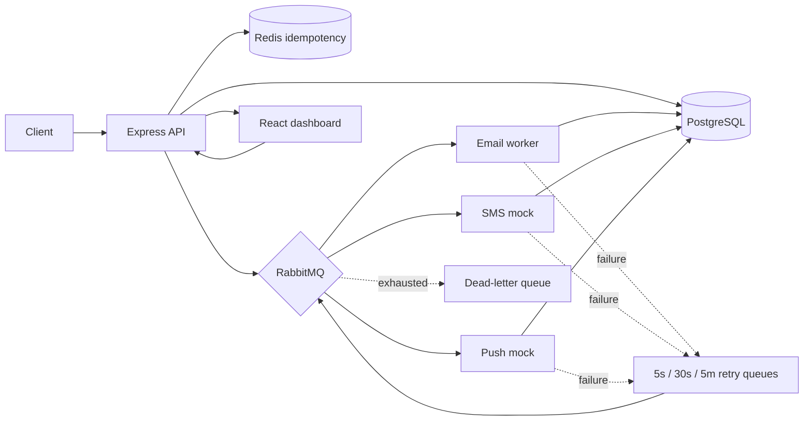

# NotifyFlow

NotifyFlow is an asynchronous notification service. The API validates and stores requests, then publishes durable jobs to RabbitMQ. Separate workers deliver them, record each attempt in PostgreSQL, and retry transient failures with increasing delays. Redis and a database uniqueness constraint provide two layers of idempotency.

## Architecture



The API never calls a delivery provider. It returns `202 Accepted` after persisting and publishing the job. RabbitMQ uses durable queues, persistent messages, publisher confirms, manual consumer acknowledgements, and a prefetch of 10. Worker containers can be scaled independently.

## Run locally

Requirements: Docker Compose v2.

```sh
cp .env.example .env
docker compose up --build --scale worker=3
```

Open:

- Dashboard: http://localhost:8080
- API health: http://localhost:3000/health
- RabbitMQ management: http://localhost:15672 (user `notifyflow`, password `notifyflow`)

PostgreSQL schema is initialized automatically on the first start. To reset all data, run `docker compose down -v` and then start the stack again.

### Real email

Email delivery defaults to mock mode so the stack runs without credentials. For SMTP, configure `SMTP_HOST`, `SMTP_PORT`, `SMTP_USER`, `SMTP_PASS`, and optionally `EMAIL_FROM` in `.env`, set `EMAIL_TRANSPORT=smtp`, then restart the services. Mailtrap SMTP is suitable for development. Never commit SMTP credentials.

SMS and push use mock providers with a configurable `FAIL_RATE` from 0 to 1. `fail@test.com` always fails and demonstrates all retry delays and the DLQ.

## API

### `POST /notifications`

```json
{
  "idempotencyKey": "order-9812-placed",
  "channel": "email",
  "recipient": "user@example.com",
  "template": "order_placed",
  "payload": { "orderId": "9812", "name": "Saloni" }
}
```

Returns `202` and `{ "id": "...", "status": "queued" }`. A repeated key returns the existing ID and status with `200`. Supported channels are `email`, `sms`, and `push`.

### Other endpoints

| Method | Endpoint | Purpose |
| --- | --- | --- |
| `GET` | `/health` | PostgreSQL, Redis, and RabbitMQ readiness |
| `GET` | `/notifications/:id` | Notification status and delivery attempt history |
| `GET` | `/notifications?status=failed&limit=50&offset=0` | Filtered, paginated notification list |
| `POST` | `/notifications/:id/retry` | Manually requeue a failed notification |
| `GET` | `/stats` | Counts by status, recent accepted volume, queue depth |

## Reliability and design decisions

- **RabbitMQ over Kafka:** this is task delivery with competing consumers, acknowledgements, and bounded retries, so RabbitMQ's queue model fits the scope.
- **At-least-once processing:** an unacknowledged message is redelivered after a worker disconnect. Database status checks skip already-sent messages, and idempotency keys stop duplicate submissions. External providers that support idempotency keys can further reduce the narrow crash window after provider acceptance and before the database update.
- **Retry policy:** failures enter channel-specific TTL queues for 5 seconds, 30 seconds, and 5 minutes. After those retries, the message is sent to `queue.dlq` and its database record becomes `failed`.
- **Fast acceptance:** the API only validates, stores, and confirms the queued job. Provider latency is handled by workers.
- **Email configuration:** mock mode keeps onboarding simple; SMTP mode uses Nodemailer. SMS and push are mocked by design.
- **Redis outage:** the unique PostgreSQL `idempotency_key` constraint remains the final deduplication guard.

## Demo

```sh
curl -i http://localhost:3000/notifications \
  -H 'Content-Type: application/json' \
  -d '{"idempotencyKey":"welcome-001","channel":"email","recipient":"demo@example.com","template":"welcome","payload":{"name":"Saloni"}}'
```

To force a terminal failure, submit the same request shape to `fail@test.com`, then watch the `retrying` status, RabbitMQ retry queues, and the failed row in the dashboard. Select **Retry** after it reaches the DLQ. Repeat a request with the same idempotency key to see the original notification returned without a second send.

## Load testing

`load-test/send-10k.js` contains a k6 scenario that submits 10,000 unique requests and captures request latency. Run it with the stack up and k6 installed:

```sh
k6 run load-test/send-10k.js
```

Run the stack with 1, 3, and 5 workers and compare API p95/p99 latency plus the time until the `sent` count settles. No performance numbers are checked in because they must be measured on the target machine.

## Known tradeoffs and next steps

- The API confirms a RabbitMQ publish after inserting the database row. A broker outage after the insert marks that row failed and reports a server error; an outbox dispatcher would close the database/broker dual-write gap for stronger recovery.
- Dashboard throughput is based on notification creation per minute, not provider completion rate. Queue depth comes from RabbitMQ.
- The demo stack uses development credentials and should not be exposed publicly as configured.
- Useful next steps include an outbox, API authentication, per-user rate limits, and measured load-test results.
